<p align="center">
  
</p>

<p align="center">
  <a href="https://www.anypayx.com"></a>
  <a href="https://www.npmjs.com/package/@anypay/client"></a>
  <a href="https://github.com/anypay/anypay-sdk"></a>
  <a href="https://github.com/anypay/anypay-sdk/blob/master/package.json"></a>
</p>

<p align="center">
  <a href="https://www.anypayx.com">Website</a> ·
  <a href="https://www.anypayx.com/docs">Docs</a> ·
  <a href="https://api.anypayx.com/api">API</a> ·
  <a href="https://www.npmjs.com/package/@anypay/client">npm</a> ·
  <a href="https://github.com/anypay">GitHub</a>
</p>

---

## What It Is & Purpose

**Anypay TypeScript SDK** (`@anypay/client`) is the official client library for integrating cryptocurrency and stablecoin payments into JavaScript and TypeScript applications. Published as `@anypay/client` on npm, this SDK provides a type-safe, promise-based interface to the Anypay payment platform, enabling merchants to request payments across Bitcoin, Ethereum, Solana, XRP Ledger, and multiple stablecoins (USDC, USDT, RLUSD) from browser and Node.js environments.

The SDK abstracts the complexity of multi-currency payment requests, invoice management, webhook verification, and real-time payment tracking through WebSocket subscriptions. It handles authentication, request validation with Joi schemas, and provides event-driven patterns for monitoring invoice state changes.

## Why Use It

**Anypay TypeScript SDK** is built for developers who need reliable, type-safe cryptocurrency payment integration without managing low-level API details or multi-chain complexities.

- **Who it's for:** JavaScript/TypeScript developers building e-commerce platforms, SaaS applications, merchant dashboards, POS systems, or any application requiring peer-to-peer cryptocurrency payments. Perfect for merchants who want customers to pay directly on-chain while maintaining complete control over payment logic and business workflows.

- **Where it fits:** The SDK sits between your application code and the Anypay API (`api.anypayx.com`). It transforms payment requests into multi-currency invoices, tracks payment state through the platform's event system, and verifies webhook callbacks when payments settle on-chain. Use it alongside `walletbot` for self-custodial automated payments, or integrate with `web3-checkout-vite` for hosted checkout flows.

**Key advantages:**

- **Multi-currency in one call**: Request payments across BTC, ETH, SOL, XRP, stablecoins, and altcoins (DOGE, LTC, DASH, BCH, BSV) with a single unified API
- **Type-safe**: Full TypeScript definitions for every class, method, and schema
- **Real-time updates**: Built-in WebSocket client (`connectWebsocket()`) for live invoice status changes
- **Webhook verification**: Secure shared-secret validation for payment confirmations
- **Event-driven**: EventEmitter pattern for monitoring invoice lifecycle and payment events
- **Validation built-in**: Joi-based schema validation ensures payment requests are correct before they hit the API
- **Promise-based**: Modern async/await patterns throughout; no callbacks

## How It Works

<p align="center">
  
</p>

The Anypay TypeScript SDK orchestrates a four-step payment flow:

1. **Merchant App** – Your application calls `anypay.request()` or `app.createInvoice()` with payment parameters: currencies, amounts, destination addresses, and optional webhook/redirect URLs.

2. **@anypay/client** – The SDK validates the request template using Joi schemas, authenticates with your API key (bearer token), and POSTs the invoice creation request to `api.anypayx.com/r`.

3. **Anypay API** – The platform generates a universal payment invoice (`invoice_uid`) with payment options for each requested currency/chain combination. Returns invoice URI (`pay:?r=...`), checkout URL (`webpage_url`), and payment options array.

4. **Payment Verified** – Customer pays on-chain. Anypay detects the transaction, updates invoice status to `paid`, fires webhook callback (if configured), and emits WebSocket events. SDK provides `awaitPayment()` polling or event listeners for state changes.

**Core SDK components:**

- **`App` class**: Main SDK entry point with authentication, invoice creation (`request()`, `createInvoice()`), invoice lookup (`getInvoice()`, `show()`), and WebSocket connection management
- **`Invoice` class**: Represents a payment request with status tracking, event subscriptions, and payment confirmation retrieval
- **`PaymentRequest` interface**: Type-safe structure for invoice data (`uid`, `uri`, `status`, `template`)
- **`PaymentOption` class**: Represents a single currency/chain payment option with amount and address
- **`schema` exports**: Joi validation schemas for `PaymentRequestTemplate` and `PaymentRequestOptions`
- **WebSocket client**: Persistent connection for `invoice.paid`, `invoice.cancelled`, and other real-time events

The SDK defaults to production (`api.anypayx.com`, `ws.anypayx.com`) but accepts custom `apiBase` and `websocketUrl` for testing or self-hosted deployments.

## Quickstart / How to Use It

### Installation

```bash
npm install @anypay/client
```

Or with Yarn:

```bash
yarn add @anypay/client
```

### Basic Usage: Create a Payment Request

```typescript
import anypay from '@anypay/client';

// Create a Bitcoin payment request
const paymentRequest = await anypay.request([{
  currency: 'BTC',
  to: [{
    address: '1A1zP1eP5QGefi2DMPTfTL5SLmv7DivfNa',
    amount: 0.005,
    currency: 'BTC'
  }]
}]);

console.log(paymentRequest.uid);         // Invoice unique ID
console.log(paymentRequest.uri);         // BIP-21 payment URI
console.log(paymentRequest.webpage_url); // Checkout page URL
```

### Multi-Currency Payment Request

Request payment in multiple stablecoins and cryptocurrencies simultaneously (payer chooses which to use):

```typescript
import anypay from '@anypay/client';

const paymentRequest = await anypay.request([
  {
    currency: 'USDC',
    chain: 'ETH',
    to: [{
      address: '0xA0b86991c6218b36c1d19D4a2e9Eb0cE3606EB48',
      amount: 150.00,
      currency: 'USD'
    }]
  },
  {
    currency: 'USDT',
    chain: 'SOL',
    to: [{
      address: 'GZ3Z1e5v1e5v1e5v1e5v1e5v1e5v1e5v1e5v1e5v',
      amount: 150.00,
      currency: 'USD'
    }]
  },
  {
    currency: 'BTC',
    to: [{
      address: 'bc1qxy2kgdygjrsqtzq2n0yrf2493p83kkfjhx0wlh',
      amount: 150.00,
      currency: 'USD'
    }]
  }
], {
  webhook_url: 'https://mystore.com/webhooks/anypay',
  redirect_url: 'https://mystore.com/checkout/complete',
  secret: 'my-webhook-secret',
  metadata: {
    orderId: 'ORD-12345',
    customerEmail: 'customer@example.com'
  }
});
```

### Using Custom App Instance with API Key

```typescript
import { app } from '@anypay/client';

const myApp = app({
  apiKey: 'your-api-key-here',
  apiBase: 'https://api.anypayx.com',
  connectWebsocket: true  // Enable real-time updates
});

const invoice = await myApp.createInvoice([{
  currency: 'ETH',
  to: [{
    address: '0x742d35Cc6634C0532925a3b844Bc9e7595f0bEb',
    amount: 0.1,
    currency: 'ETH'
  }]
}]);

console.log(invoice.invoice.uid);
```

### Monitor Payment Status with WebSockets

```typescript
import { app } from '@anypay/client';

const myApp = app({
  apiKey: 'your-api-key',
  connectWebsocket: true
});

// Listen for invoice paid events
myApp.on('invoice.paid', (payload) => {
  console.log('Payment received!', payload);
});

// Create invoice
const invoice = await myApp.createInvoice([{
  currency: 'BTC',
  to: [{ address: 'bc1q...', amount: 0.001, currency: 'BTC' }]
}]);

// Invoice events are emitted automatically when status changes
```

### Fetch and Track Invoice

```typescript
import { app } from '@anypay/client';

const myApp = app({ apiKey: 'your-api-key' });

const invoice = await myApp.getInvoice({ uid: 'invoice-uid-here' });

console.log(invoice.paymentRequest.status); // 'unpaid' | 'confirming' | 'paid' | 'cancelled'

// Poll for payment
const payment = await invoice.awaitPayment({
  interval: 10000,  // Check every 10 seconds
  timeout: 600000   // Give up after 10 minutes
});

console.log('Payment received:', payment);
```

### Payment Options

When creating a payment request, you can customize behavior with these options:

```typescript
interface PaymentRequestOptions {
  webhook_url?: string;    // URL to receive payment notifications
  redirect_url?: string;   // URL to redirect customer after payment
  secret?: string;         // Shared secret for webhook verification
  metadata?: any;          // Custom data (order IDs, customer info, etc.)
}
```

**Example with all options:**

```typescript
const request = await anypay.request([{
  currency: 'USDC',
  chain: 'ETH',
  to: [{
    address: '0xYourAddress',
    amount: 100,
    currency: 'USD'
  }]
}], {
  webhook_url: 'https://api.mystore.com/anypay-webhook',
  redirect_url: 'https://mystore.com/order/confirmation',
  secret: 'secure-webhook-secret-key',
  metadata: {
    orderId: 'ORD-98765',
    customerName: 'Alice',
    items: ['Product A', 'Product B']
  }
});
```

### Available Exports

```typescript
// Main SDK exports
import anypay from '@anypay/client';              // Default app instance
import { app } from '@anypay/client';             // Create custom app
import { Invoice, getInvoice } from '@anypay/client';
import { Payment } from '@anypay/client';
import { Confirmation } from '@anypay/client';
import { PaymentOption } from '@anypay/client';
import { PaymentRequest } from '@anypay/client';
import { schema } from '@anypay/client';          // Joi validation schemas
import { events, subscribe } from '@anypay/client'; // WebSocket helpers
```

## Next Moves for Growth

The Anypay TypeScript SDK is production-ready but has clear paths for expansion:

1. **Publish type definitions properly** – The `package.json` currently declares `"types": "dist/src/lib/index.d.js"`, but TypeScript declaration files use `.d.ts`. Update to `"types": "dist/src/lib/index.d.ts"` and ensure the build script (`tsc`) generates `.d.ts` files alongside JavaScript output. This will fix IDE autocomplete and type-checking for downstream consumers.

2. **Upgrade dependencies** – Several packages are outdated:
   - `@types/node` is pinned to `^14.6.0` (Node 14 is EOL); bump to `^20.0.0` or `^22.0.0`
   - `typescript` is `^4.0.2`; consider upgrading to `^5.0.0` for modern TypeScript features
   - `axios` is `^0.27.2`; latest is `^1.x` with security fixes
   - `ws` (WebSocket) is `^8.13.0`; check for latest stable (`^8.18.0` as of late 2024)
   - Run `npm audit` and address any high/critical vulnerabilities

3. **Add ESM support** – The SDK currently publishes CommonJS only (`main: "dist/src/lib/index.js"`). Add `"type": "module"` and dual CommonJS/ESM builds, or use `"exports"` field for conditional exports. This enables tree-shaking and better compatibility with modern bundlers (Vite, Next.js, etc.).

4. **Improve test coverage** – The `test/` directory exists but test commands reference `mocha --require=ts-node/register test/*.ts`. Expand test suites to cover:
   - `App.request()` with mock API responses
   - `Invoice` state transitions and event emission
   - WebSocket reconnection logic
   - Joi schema validation edge cases
   - Add CI integration (GitHub Actions) to run tests on every PR

5. **Document error handling** – The SDK throws errors from HTTP failures (`error.response.data.error`, `error.response.error`) but doesn't document error types or codes. Add an error reference section showing common failure modes (invalid API key, malformed template, network timeout) and how to handle them. Consider wrapping errors in custom error classes (`AnypayAPIError`, `AnypayValidationError`) for better typed error handling.

6. **Add retry logic and rate limiting** – HTTP requests (`superagent`, `axios`) have no built-in retry for transient failures. Implement exponential backoff for 5xx errors and network timeouts. Respect `Retry-After` headers if the API returns 429.

7. **Publish inline JSDoc comments** – Many classes and methods lack JSDoc annotations. Add documentation comments to `App`, `Invoice`, `PaymentRequest`, and exported functions so IDEs display inline help. Example:
   ```typescript
   /**
    * Create a payment request invoice.
    * @param template - Payment request template with currencies and amounts
    * @param options - Optional webhook, redirect, and metadata configuration
    * @returns Promise resolving to PaymentRequest with invoice UID and URIs
    */
   async request(template: PaymentRequestTemplate, options?: PaymentRequestOptions): Promise<PaymentRequest>
   ```

## Anypay Ecosystem & License

**Anypay TypeScript SDK** is part of [Anypay](https://www.anypayx.com) — Bitcoin & Stablecoin payments for business. Merchants and developers use Anypay to accept BTC, ETH, SOL, XRP, and stablecoins (USDC, USDT, RLUSD, NUSD) through invoices, APIs, SDKs, webhooks, WooCommerce plugins, and mobile point-of-sale apps.

| Project | Role |
| --- | --- |
| [anypay](https://github.com/anypay/anypay) | Invoice & payments platform / API (`@anypay/server`) |
| **[anypay-sdk](https://github.com/anypay/anypay-sdk)** | **TypeScript SDK for browser & Node.js (`@anypay/client`)** |
| [web3-checkout-vite](https://github.com/anypay/web3-checkout-vite) | Current checkout UI (`checkout.anypayx.com`) |
| [walletbot](https://github.com/anypay/walletbot) | Self-custody headless wallet (`@anypay/walletbot`) |

### Related Repositories

- [anypayx.com](https://github.com/anypay/anypayx.com) – Marketing site, merchant dashboard, and developer documentation
- [merchant-app](https://github.com/anypay/merchant-app) – iOS & Android point-of-sale native apps
- [anypay-woocommerce](https://github.com/anypay/anypay-woocommerce) – Official WooCommerce plugin for WordPress e-commerce

### License

This project is licensed under the **ISC License** as declared in `package.json`. See the repository for terms.

---

<p align="center">
  <a href="https://www.anypayx.com"></a><br/>
  <sub>Bitcoin & Stablecoin Payments For Business · <a href="https://www.anypayx.com">anypayx.com</a> · <a href="https://x.com/xanypay">@xanypay</a></sub>
</p>
